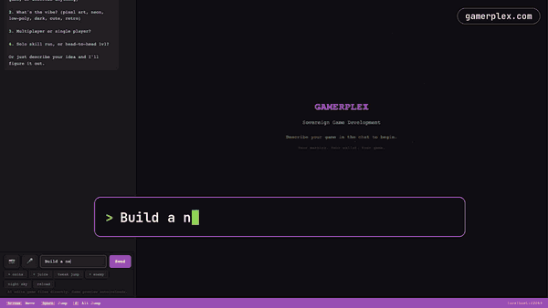

# @gamerplex/dev

**Your game studio in a browser tab.** Connect your AI, describe a game, play it live at `localhost:42069`.

Your machine. Your AI. Your game.



*One sentence → a playable neon street, built from open-licence parts with the [Sovereign World Kit](https://github.com/gamerplex/sovereign-world-kit).*

## Quick start

```bash
git clone https://github.com/gamerplex/gamerplex-dev && cd gamerplex-dev
npm install
npm start ./games/my-game
```

Open <http://localhost:42069>: chat on the left, your game live on the right. Every change hot-reloads in the preview.

## Connect your AI

Pick one with the **Brain** chip (top right). Switch any time; the chat carries over.

| AI | Setup |
|---|---|
| **Claude Code** (default) | `npm install -g @anthropic-ai/claude-code`, then `claude` once to log in |
| **Claude API** | paste your `ANTHROPIC_API_KEY` in the picker |
| **OpenAI** | paste your `OPENAI_API_KEY` |
| **Google Gemini** | paste your `GEMINI_API_KEY` |
| **Local (Ollama)** | install [Ollama](https://ollama.com), `ollama pull qwen2.5-coder`: fully offline, no key |

Keys stay in your browser and on your machine. There's no Gamerplex server in the loop.

## Build 3D worlds with the Sovereign World Kit

Give your AI the kit's `build-street` skill and it builds original 3D worlds from open-licence parts, each with a licence and a provenance record. Needs [Blender](https://www.blender.org/download/) (free) and Python 3.

```bash
git clone https://github.com/gamerplex/sovereign-world-kit ~/sovereign-world-kit
python3 ~/sovereign-world-kit/Tools/kit/cc0_fetch.py          # once: open-licence materials (~250 MB)

mkdir -p games/my-street/.claude/skills && cp games/blank/index.html games/my-street/
ln -s ~/sovereign-world-kit/skills/build-street games/my-street/.claude/skills/
npm start ./games/my-street
```

Then type **"Build a neon cyberpunk street with gamerplex"**. About 90 seconds later press **Restart Game** and walk it (WASD + mouse). The game folder now holds `street.glb`, `street.provenance.json`, `LICENSE` and a playable `index.html`. Works with World Kit 0.1.1 or later.

## Where your game runs

| Target | Status |
|---|---|
| **Web** (three.js, Phaser, single-file HTML, Next.js routes) | ✅ live: the game folder is a complete web game |
| **Unreal Engine** | coming soon (World Kit modules already build natively in Unreal) |
| **Unity** | coming soon |
| **Godot** | coming soon |

## Coming next

- **One tap to publish:** host your game, get a challenge link to share, and sign in with Flipcash to bring your community.
- **Record and share:** capture your gameplay with a selfie bubble and post it with your challenge link.
- **Publish to the Gamerplex arcade** on Solana, where players pay a few cents per play.

## Features

- **Chat with any AI** and watch the game change live
- **Compare mode:** two AIs on the same prompt, side by side
- **Screenshot capture:** send the game canvas with a bug report
- **Voice input:** hold V to talk
- **Update toast:** "Restart Game" when files change, never a silent reload
- **Session log:** every turn (model, latency, tools, errors) logged locally

## Project detection

The dev server detects what kind of project the game folder is and loads matching skills into the AI's prompt: single-HTML games, Next.js routes, three.js / React Three Fiber, Anchor (Solana) programs and Gamerplex arcade routes.

## Folder structure

```
gamerplex-dev/
├── dev-server.js       localhost:42069 (the whole app)
├── src/
│   ├── ollama-agent.js brain-agnostic agent (Ollama + OpenAI-compatible)
│   └── session-log.js  per-turn telemetry
├── skills/             loaded into the AI's prompt by project type
├── games/              your games (blank/ is the starter)
└── test/               node:test suite
```

## Versions

See [CHANGELOG.md](CHANGELOG.md). Current: **0.1.0**.

## Licence

MIT.
